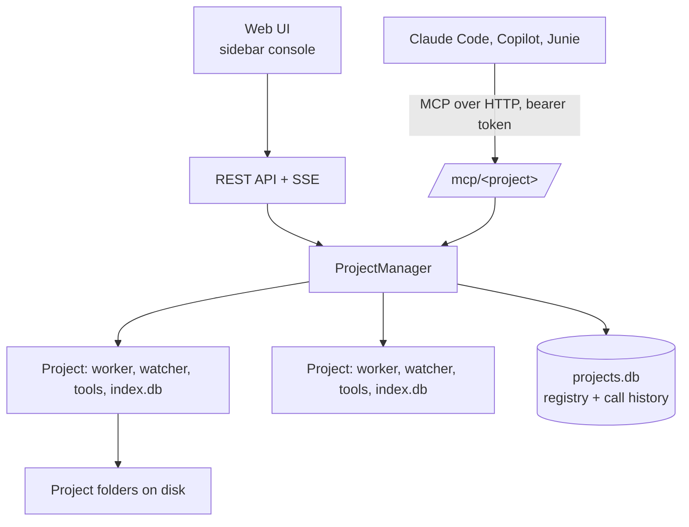

# RefDex Host: Standalone MCP Server Plan

2026-10-09 (replaces the 2026-10-08 version, which was built around a Docker image)

## Status (2026-10-09)

Work is on branch `host/phase0-index-queue` (worktree `../refdex-host`).

- **Phase 0 done:** `IndexQueue` extracted from `serve.ts`; baseline checks identical before and after. Not yet checked by hand: the VS Code extension and the IntelliJ plugin starting the daemon.
- **Phase 1 backend done** except memory rule 4 (idle projects going cold) and the `--open` launcher flag. MCP uses sessions (a stateless endpoint lost the client's name).
- **Phase 2 panel built:** sidebar, activity, settings, browse index, connect clients, add-project dialog with folder picker, quit button, cookie login and one-time login link. Deviations from the plan: the progress bar is indeterminate (the worker reports no percentage), and Settings is read-only (remove and add again to change a project). The layout has not been looked at in a browser yet; the logic is covered by the host tests.
- **Phase 3 measured, not changed:** see the Phase 3 section. The catch-up scan is cheap on a local disk; the first index (40 s on Guava) is the cost.
- **Phase 4, first part done:** `refdex-host --open` (starts the host in the background if needed, opens the browser on a one-time link, reuses a running host) and `npm run build` (bundle with the panel and parsers beside it, `refdex-host` bin). Not done: publishing the npm package, per-OS executables from CI, the Windows installer and the macOS and Linux launchers (these need those machines to verify), memory rule 4 is built (see Memory management).

## Overview and goals

Today RefDex runs inside an IDE: the VS Code extension or the IntelliJ plugin starts the daemon (`refdex serve`) and AI clients start `refdex mcp` over stdio. This plan adds a third way to run it: **RefDex Host** (`refdex host`), a standalone server with no IDE involved. It runs natively on the developer's machine from a command window, indexes the code itself, serves MCP over HTTP, and serves a web page to manage projects and watch what AI clients ask for.

- Index several projects, each with its own database.
- Serve each project's MCP tools over HTTP at `/mcp/<project>/`.
- Web UI at `http://localhost:7420` to add a project by picking a folder, see its status, and see MCP activity.
- Runs with one command (`npx` or an executable). No Docker.
- `refdex mcp` and `refdex serve` stay as they are for the IDEs.

## Decisions

| Question | Decision |
| --- | --- |
| UI | Option A, sidebar console: project list on the left, detail on the right (mockups reviewed 2026-10-08) |
| Auth | Token generated on first start, printed in the logs and shown in the UI |
| Package | New `packages/host` |
| IDE entry points | `refdex mcp` and `refdex serve` unchanged |
| Packaging | Native process. npm package for `npx` first; per-OS executables from GitHub Releases later |
| Launch | Installer adds a Start menu entry "RefDex"; clicking it starts the host if needed and opens the default browser on the control panel (Windows first; macOS and Linux later) |
| Dropped | Docker image and ghcr.io (extra difficulty: mounts, path mapping, watcher events); the GitHub Copilot app plugin (not the right solution) |

## What exists and what is missing

Reused as is: the indexer, workers and watcher (`packages/core`, `packages/server/src/serve.ts`, `watcher.ts`, `worker.ts`), the tool logic (`tools.ts`), the server factory (`mcp.ts`) and the usage log format (`usage.ts`).

Missing:

1. **One project per process.** Everything takes a single `root` and `dbPath`. Needs a project registry.
2. **No usable HTTP MCP.** `mcp-http.ts` is debug-only, stateless, bound to 127.0.0.1, without auth.
3. **Folder picker.** A browser cannot read local paths. The host process can: it lists real folders for the UI, limited to roots the user allows (default: the home folder).
4. **Usage storage.** The UI needs queryable history, not only a JSONL file.
5. **Faster scans.** See the scanning phase below.

Because the host runs on the same machine as the code, none of the container problems apply: paths are the paths the AI client sees, `git` is the user's own, and file watching is native.

## Architecture

Data folder (per user): `projects.db` and `<project-id>/index.db`, in `~/.refdex/` (Windows: `%APPDATA%\refdex\`), overridable with `REFDEX_HOME`. Nothing is written into the project folders.

## Phases

### Phase 0: Protect the IDEs, then extract

`packages/server` is bundled into both IDE products (the VS Code build bundles `src/main.ts`; the IntelliJ build runs `build:sea` and talks to the daemon over JSON lines). The host must not destabilize them, so this phase adds, and changes existing code as little as possible.

- **Baseline first.** On a separate branch, run `npm test`, `npm run check-types` and `refdex selftest` on the built executable, and record the results. `packages/server/test/serve.test.ts` already covers the daemon protocol.
- **Add, don't rewrite.** `ProjectManager` is new and lives in `packages/host`. It wraps the existing `Indexer`, `RefdexTools`, `createServer` and the worker. It does not exist today.
- **Only one extraction in `packages/server`:** move the indexing queue (merge pending requests, one run at a time) out of `serve.ts` into a small shared function that `serve.ts` calls. Its behavior and the stdio protocol stay identical. `mcp.ts` and `tools.ts` are used as they are; if the host needs a new option, add it as an optional parameter with the current behavior as the default.
- **No change to the index format in this phase.** The scanning phase below changes it deliberately, with its own review.
- Keep the IntelliJ files with uncommitted changes off this branch.
- Done when: the baseline results are identical after the extraction, both IDE bundles still build, and the IntelliJ plugin and VS Code extension still start the daemon and show status against the new build.

### Phase 1: `packages/host` backend

- HTTP server with MCP (Streamable HTTP, sessions) at `/mcp/<project>/`.
- Bearer-token auth for `/mcp` and `/api`. Token generated on first start, stored in the data folder, printed in the console. `REFDEX_TOKEN` overrides it. Binds to 127.0.0.1 by default, with an allowed-hosts list (DNS-rebinding protection); binding wider is an explicit option.
- REST API: list, add, remove, reindex and rebuild projects; per-project stats and index browse; folder listing for the picker.
- `GET /api/events`: server-sent events for indexing progress and new MCP calls.
- `projects.db`: project registry (id, name, root, include/exclude/languages) and call history (time, project, client, tool, arguments, ms, characters, error).
- Command: `refdex host [--port 7420] [--home <dir>]`.
- Done when: an integration test adds a fixture project through the API, waits for `indexed`, and calls the tools through `/mcp/<id>/`.

### Memory management (part of Phase 1)

Each project costs a worker thread with its tree-sitter parser, a file watcher (on Linux, inotify watches are a kernel limit, `fs.inotify.max_user_watches`) and SQLite connections. The host manages this in tiers:

| Tier | What is open | Cost | Cost to wake |
| --- | --- | --- | --- |
| Hot | Index worker, parser, file watcher, read connection | Highest | n/a |
| Warm | Read connection only | Small (SQLite page cache) | Instant |
| Cold | Nothing open; a row in `projects.db` | None | A few ms to reopen the DB |

Rules, in the order to build them:

1. **Worker on demand.** Start a project's index worker only when there is work (a change batch or a manual reindex) and stop it after a short idle period (default 60 s). `ProjectManager` owns this; the worker's message protocol is unchanged.
2. **Concurrency cap.** At most K projects index at the same time (default 2); the rest queue.
3. **Hard limits.** Pass `resourceLimits` (`maxOldGenerationSizeMb`) to each worker so a runaway parse cannot take down the host.
4. **Project TTL, only with more than one project.** After N idle minutes (default 15, configurable) with no MCP call and no UI view, a project goes cold: connections closed, watcher stopped. A single project never expires, and a per-project "keep always hot" setting exempts one.

Rules 1 to 3 reduce memory without ever leaving an index stale. Rule 4 was built on request (`--sleep-after`, default 15 minutes, 0 = never), although the measurement below shows it is not needed for memory.

**Measured 2026-10-09** (Guava and a small project, host started with both): process memory peaks at about 740 MB during indexing. With rule 4 off, rule 1 alone brings it to 194 MB 60 seconds after indexing ends. With rule 4 on, it ends at 202 MB. So the project timeout frees almost no extra memory; what it releases is each project's file watchers (on Linux a per-user limit, `fs.inotify.max_user_watches`, which several large projects can reach) and its database connection. Waking Guava costs about 90 MB again and a catch-up scan of about 1.5 s. Keep the default for people with many projects; it can be set to 0.

**Waking a cold project.** It has no watcher, so files may have changed while it slept. Tool answers read source from disk, so code is current, but stored line ranges can be off. On wake, run the incremental catch-up before answering if it is quick (it is, once the scanning phase is done); otherwise answer from the old index and mark the project "catching up" in the UI.

**Measure first.** Before choosing defaults, measure on the Guava benchmark repo (3,275 files) and on a few smaller ones: resident memory per hot, warm and cold project; wake time (reopen plus catch-up scan); watches per project.

### Phase 2: Web UI (option A)

Served by the host process itself, so `refdex host` is all that has to run.

- Plain HTML, CSS and a small script. No front-end build step.
- Sidebar: project list with state pills (ready, indexing %, sleeping, catching up, error) and "Add project".
- Detail page: header with Reindex / Rebuild / Remove, four counters (files, symbols, calls today, index size), tabs for Activity, Settings, Browse index and Connect clients.
- Add-project dialog with the folder picker, language and include/exclude options.
- Connect clients tab: copy-ready config for Claude Code, Copilot and Junie, with the project's URL and token.
- Light and dark themes.

### Phase 3: Faster indexing (shared with the IDEs)

Everything here changes shared code, so each step gets the Phase 0 baseline before and after, and a release note for the IDE products.

**Measured 2026-10-09** on Guava (3,275 Java files, 43 MB of source, commit `4d41665af1`) with the executable built from `aaeee28`, on a 2-core machine with 5.7 GB of RAM, warm file cache, local disk:

| Run | Time | Peak memory |
| --- | --- | --- |
| First index | 40.4 s | 623 MB |
| Second run, nothing changed (catch-up scan) | 1.6 s (1.4 s reported) | 133 MB |

Where the 40 s of the first index goes (CPU profile; async frames make the inclusive figures approximate):

| Part | Time | Share |
| --- | --- | --- |
| Parsing (tree-sitter WASM and symbol extraction) | about 10.8 s | 26% |
| Resolving calls and references into edges | about 8.5 s | 21% |
| Writing files, symbols and edges to SQLite (`replaceFile`) | about 6.1 s | 15% |
| Edge updates (`setEdgeTarget`) | about 1.6 s | 4% |
| Garbage collection | about 3.2 s | 8% |
| Reading files, hashing, walking the folder | under 0.5 s | about 1% |

What this means:

- **The plan's first guess was wrong for local disks.** Reading and hashing every file on each catch-up costs 1.4 s on Guava, so skipping unchanged files by modification time (old step 2) would save at most 1.4 s there, and `git ls-files` (old step 3) almost nothing. They can matter on slow storage (network drives, WSL `/mnt/c`, a cold cache), which was not measured; the profile gives no reason to do them first.
- **The cost is the first index.** Parsing, edge resolution and database writes make up about two thirds of it.
- **Memory.** Indexing Guava peaks at about 620 MB in one process. The host's `resourceLimits` default for an index worker must be well above that (start at 2 GB), and two projects indexing at once can need over 1.2 GB.
- **Parallel parsing helps little on this machine.** With 2 cores, the best case is saving part of the 10.8 s parsing time while using more memory.

Revised order:

1. **Cold-cache measurement.** Repeat the catch-up scan with a cold file cache (needs root to drop caches, or a reboot) and on a slow mount, to decide whether the modification-time and `git ls-files` ideas are worth a schema bump at all.
2. **Cheap database experiments for the first index**, each timed on Guava: larger SQLite cache (`cache_size`), `temp_store = MEMORY`, and `synchronous = OFF` for the bulk first index only. Keep what saves more than about 5%.
3. **Look at edge resolution** (`ReferenceResolver.resolveAll`, 8.5 s) and `replaceFile` row counts: Guava has about 500,000 edge rows for 80,000 symbols. Check for repeated lookups that a per-run cache would remove.
4. **Only if the cold-cache result calls for it:** skip unchanged files by modification time and size (needs a schema version bump, so IDE indexes rebuild once on update), and list files with `git ls-files`.
5. **Parse in several workers on the first index** only if a typical user machine has the cores and memory; measure on a 4-core machine first.

Not planned: storing relative paths. Each path is stored once per file (symbols refer to a `file_id`), so the size gain is small.

### Phase 4: Packaging, installer, tests and docs

- npm package for `npx @refdex/host` (needs Node 22.18+ because of `node:sqlite`).
- Per-OS executables built in CI and attached to GitHub Releases (the IntelliJ plugin needs the macOS and Windows builds too).
- Optional: start at login (Task Scheduler on Windows, a systemd user service on Linux), documented.

#### Installer and Start menu entry

Goal: after installing, "RefDex" appears in the Start menu; clicking it opens the default browser on the control panel, starting the host first if it is not running.

- **Launcher behavior** (`refdex host --open`, which the shortcut runs):
  1. Read the host's lock/pid file in the data folder and check that the port answers.
  2. If the host is not running, start it in the background (no console window), wait until it answers on `/api/health`.
  3. Open the default browser on `http://localhost:7420/`. If it is already running, only step 3 happens, so repeated clicks never start a second host.
- **Signing in from the shortcut.** The browser needs the token, but putting it in the URL leaves it in browser history. The launcher opens `http://localhost:7420/login?code=<one-time code>`; the host exchanges the code for a cookie and redirects to the panel. The code is valid once and for a few seconds.
- **Stopping it.** With no window, there must be a way to quit: a "Quit RefDex" button in the panel (confirms, then exits the host), and the process is visible in Task Manager. A tray icon is not planned for the first version.
- **Windows installer** (the primary target, since "Start menu" is a Windows idea): an Inno Setup script (free, scriptable in CI) that
  - installs `refdex.exe` (the single executable) per user, with no administrator rights needed;
  - creates the Start menu shortcut "RefDex" running `refdex.exe host --open`, with the RefDex icon;
  - offers "Start RefDex when I sign in" (unchecked by default);
  - on uninstall removes the program, the shortcut and the start-at-login entry, and asks whether to also delete the data folder (`%APPDATA%\refdex\`), so indexes are not lost by accident.
- **macOS and Linux** get the same behavior, packaged natively: a `.app` bundle (macOS) and a `.desktop` file under `~/.local/share/applications` (Linux), both running `refdex host --open`. These come after Windows.
- **Depends on** the Windows executable from the CI work above, and on the launcher flags and login-code endpoint from Phase 1.
- **Signing.** An unsigned installer shows a SmartScreen warning on Windows (and Gatekeeper on macOS). Decide before the first release whether to buy a code-signing certificate; until then, document the warning.
- Done when: on a clean Windows machine, running the installer adds the shortcut; clicking it opens the panel in the default browser; clicking again does not start a second host; uninstalling removes everything except the data folder unless asked.
- Tests: auth (missing and wrong token, one-time login code used twice), two projects staying isolated, folder picker confinement, SSE events, scanning phase results, the launcher not starting a second host.
- Docs: README layout table and a "Run the host" section, changelog entry, and a note in `packages/vscode/README.md` that the IDE flow is unchanged.

## Risks and open questions

- **Token in the console.** Convenient, but anyone who can see the console output can use it. Document that, and offer `REFDEX_TOKEN` and rotating from the UI.
- **Folder picker scope.** A web page that lists the file system is a risk if the host is reachable from other machines. Default to localhost only, require the token, and limit browsing to allowed roots.
- **Version skew.** An index written by a different RefDex version is replaced (`replacedOutdated`), so an upgrade reindexes every project. Show this clearly in the UI.
- **Memory.** See "Memory management" under Phase 1. Open: the default TTL, which depends on the measured wake time.
- **Schema change in Phase 3.** It touches the IDE products' index. Treat it as its own change with its own review and release note.
- **IDE regression.** Any edit to `packages/server` or `packages/core` must re-run the Phase 0 baseline before merging.
- **Installer trust.** Unsigned installers trigger SmartScreen or Gatekeeper warnings. A signing certificate costs money; decide before the first release.
- **Background process.** A host with no window can be forgotten and keep using memory. The panel's Quit button, the memory tiers and the optional (off by default) start-at-login are the mitigation.
- **Remote access.** Not a goal. If wanted later, a free tunnel in front of the host works because of the token; document it, don't build it.
